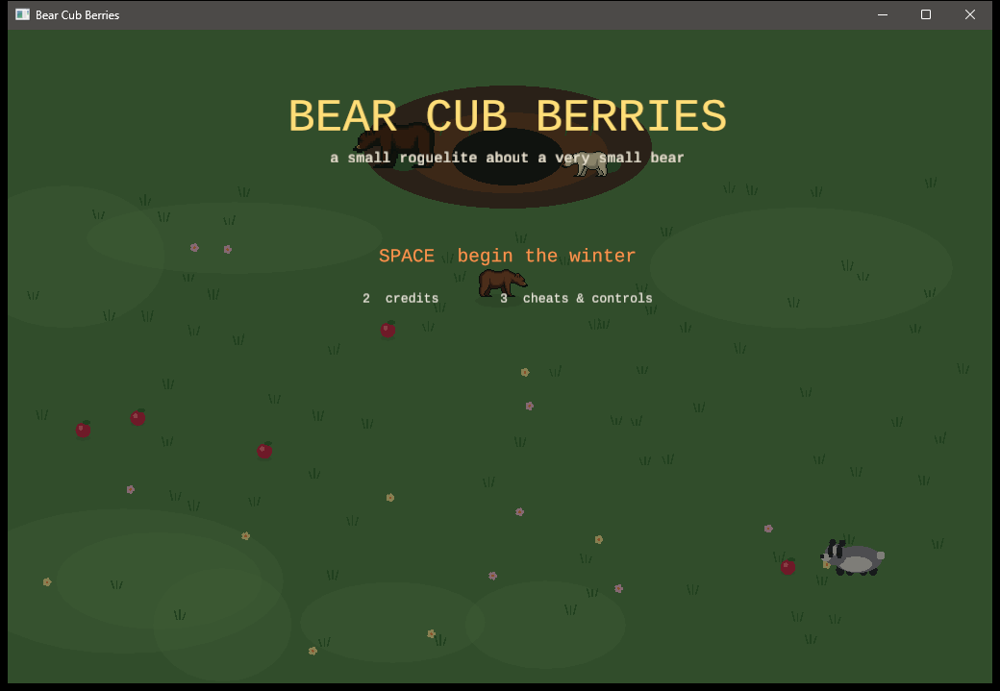

# Bear Cub Berries

A small roguelite about a very small bear, built on the `ggez` in this repository.

Winter is close. Old Mama cannot leave the den and your little brother Pip is too
sick to walk, so it falls to you — a cub who still fits under Mama's chin — to
fill the den before the first snow.



## Running it

From the repository root:

```sh
cargo run -p bear-cub-berries            # debug build
cargo run -p bear-cub-berries --release  # smoother, use this to actually play
```

Resources are resolved from this crate's `resources/` directory via
`CARGO_MANIFEST_DIR`, so the binary works no matter which directory you launch it
from.

## How it plays

You walk on all fours, scoop food by brushing against it, and carry it back to the
den. Clear the day's quota before dusk, pick one of three boons, and go again.
Get to day ten and the family sleeps.

* **WASD / arrows** — walk
* **Space** — swipe (enemies have hit points; badgers can be killed)
* **C** — cuddle Mama (heals a bruise, raises her bond)
* **N** — nurse Pip (feeds him from your paws, clears every bruise)
* **1 / 2 / 3** — choose a boon, or pick a title-screen page
* **M** — hush the sound, **F1** — debug overlay, **R** — restart, **Esc** — quit

Typed cheats, because it is that kind of game: `honey`, `cuddle`, `quota`, `smasher`.

## What is in here

| Path | What it is |
| --- | --- |
| `src/main.rs` | The whole game. One file, ~3300 lines, no dependencies beyond ggez and oorandom. |
| `resources/bears/` | Three 3x4 pixel bear sheets (back / walk right / front / walk left). |
| `resources/sounds/` | Nine one-shot effects, queued and played detached so they overlap. |
| `screenshots/` | Title, a cutscene panel, and day one. |
| `ROADMAP.md` | Audit of what this is, what is weak, and what to do next. |

## Art and audio

* Bear sprites: supplied by the project owner.
* Sound effects: the Arcade Sound FX pack.
* Font: Liberation Mono (SIL Open Font License, copy included in `resources/`).
* Engine: `ggez` in this repository.
